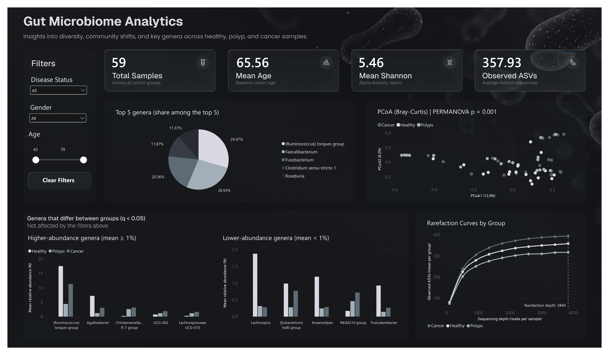

# Gut Microbiome Analytics: Healthy vs Polyps vs Colorectal Cancer

Exploring how the gut bacterial community shifts from a healthy colon to adenomatous polyps to colorectal cancer, using 16S rRNA sequencing data, Python, and an interactive Power BI dashboard.

[](https://colab.research.google.com/github/Nahlah-CS/Gut-microbiome-colorectal-analysis/blob/main/Gut_Microbiome_in_Colorectal_Disease.ipynb)



## Data source

The data come from the Kaggle dataset **[CRC Gut Microbiome ML Data](https://www.kaggle.com/datasets/aramelheni/crc-gut-microbiome-ml-data)**.

Processed gut microbiome data (16S rRNA, DADA2 pipeline). License: Apache License 2.0.

Note: the Kaggle description mentions 60 samples; the files used here contain 59 samples. The three input files are included unmodified in this repository under that license.

## Overview

This project analyzes bacterial DNA from 59 samples (19 healthy, 19 with adenomatous polyps, 21 with colorectal cancer; 6,693 distinct bacterial sequences). It asks three questions:

1. Does bacterial diversity differ between the groups?
2. Does the overall bacterial community differ?
3. Which bacterial genera differ, and could any act as early markers?

## Key findings

* The overall bacterial community differs significantly between the three groups (PERMANOVA pseudo-F = 2.28, p = 0.001), and every pair of groups differs after correction.
* Diversity shows only a borderline trend (Shannon, Kruskal-Wallis p = 0.055).
* Ten of 56 tested genera differ after FDR correction (q < 0.05): six are lower in polyps and cancer, and four rise from healthy to polyps to cancer.
* Unsupervised clustering (PCA + KMeans) did not recover the diagnoses (adjusted Rand index = 0.03), so individual profiles overlap too much to classify a person from bacteria alone.

## Repository structure

```text
├── Gut_Microbiome_in_Colorectal_Disease.ipynb   Notebook with all code and outputs
├── Gut_Microbiome_Analysis_Report.pdf           Final report
├── Gut_Microbiome_Dashboard.pbix                Power BI dashboard (open in Power BI Desktop)
├── Gut_Microbiome_Dashboard.pdf / .jpg          Dashboard export and preview
├── metadata.csv, seqtab_nochim_export.xlsx,
│   taxa_species_export.xlsx                     Input data (see Data source)
├── requirements.txt                             Python libraries
└── README.md
```

## Methods in brief

* Data matching, quality checks, and rarefaction to 3,844 reads per sample
* Alpha diversity: Shannon, Simpson, observed sequences (Kruskal-Wallis, pairwise Mann-Whitney, Benjamini-Hochberg correction)
* Beta diversity: Bray-Curtis distance, PCoA, PERMANOVA (999 permutations)
* Rarefaction curves to check sequencing depth
* Genus-level differential abundance (Kruskal-Wallis with FDR correction)
* PCA and KMeans clustering

## How to reproduce

1. Open the notebook in Google Colab (button above) or in Jupyter.
2. Place the three input files (`metadata.csv`, `seqtab_nochim_export.xlsx`, `taxa_species_export.xlsx`) where the notebook can read them. The first cells upload them in Colab.
3. Run all cells from top to bottom.
4. Install the libraries listed in `requirements.txt` if running locally.

## Dashboard

Built in Power BI. It includes sample counts, mean age, mean Shannon diversity, observed ASVs, a PCoA map, top genera, genera that differ between groups, and rarefaction curves, with filters for disease status, sex, and age. Open `Gut_Microbiome_Dashboard.pbix` in Power BI Desktop (Windows).

## Limitations

Small sample size (about 20 per group), a single sample per person (associations, not causes), relative abundances only, and exploratory genus-level tests.

## Author

**Nahlah Mohammed**  
[Portfolio](https://nahlahmohammed.framer.website/) | [GitHub](https://github.com/Nahlah-CS)

## License

Apache License 2.0 (same as the source dataset). See [LICENSE](LICENSE).
